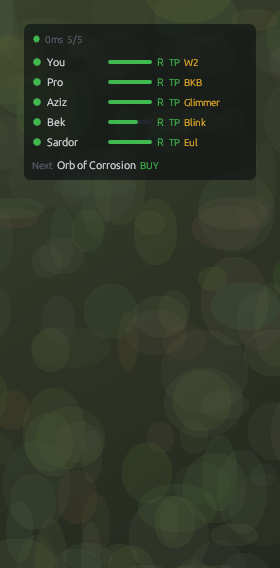
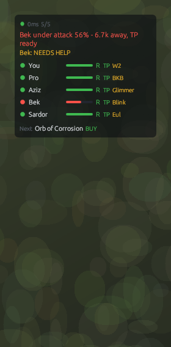
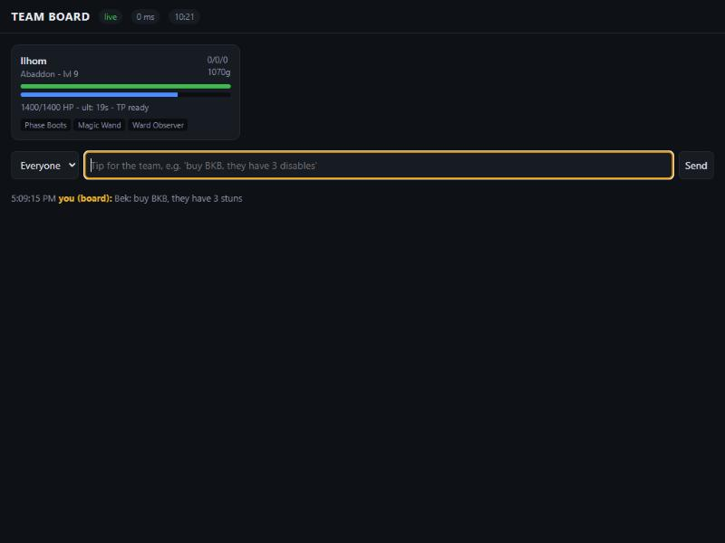

# cyberspyde dota 2

A team coordination tool for a 5-stack. Each player shares **their own** game state with the rest of the team in real time. Everyone gets an in-game overlay showing:

- **Who is under attack, right now.** It flags burst damage (12%+ HP lost within 2.5 s) and shows your distance to that teammate and whether your TP is ready.
- **Teammate status**: HP and mana, dead or alive with respawn time and buyback status, ultimate and TP cooldowns, key items (BKB, Blink, Glimmer and so on, with cooldowns), and ward stock.
- **A radar** showing where everyone is, with a pulsing ring on anyone taking damage.
- **Callouts on hotkeys**: help, group up, retreat, careful, on my way, Roshan.
- **A build helper for your hero**: next item and gold still needed, skill-order reminders, game-plan tips. It comes from the old CYBERSPYDE build database, plus builds your pro friend writes **once** instead of explaining them every game.
- **A team board** web page (for a second monitor or a phone) where anyone can send tips to one player or the whole team.

| Normal | A teammate getting ganked |
|---|---|
|  |  |

These are real screen captures of `cyberspyde-agent --demo` over a plain backdrop. Each row is one player: status dot (green ok, amber low, red under attack), HP bar, `R` = ultimate (green ready, grey with seconds), `TP`, `W2` = observer wards carried, and up to two fight-changing items. The radar and game-plan tips are off by default. The team board looks like this:



## Personal coaching (private)

The host can switch on coaching aids per player in a private `team.toml` (see `examples/team.example.toml`). It lives only on the host PC and is git-ignored. When a player connects, the relay sends them only their own switches, for example `["team_mode_banner", "fight_focus"]`, plus an alert text size. Nobody receives anyone else's profile, and the host's `notes` never leave the file. Players just see clearer prompts.

| Switch | What the player sees |
|---|---|
| `team_mode_banner` | A banner across the top: TEAM FIGHTING / TEAM RETREATING / GROUP UP. It turns red ("TURN AROUND - GO IN" or "STOP - RUN BACK") when the player moves the opposite way from the team |
| `fight_focus` | During a fight, the build line, radar and notes disappear |
| `join_fight_nudge` | "Fight 5.2k away - TP in" |
| `isolation_warning` | "You're alone - X 6.1k" (mid-game, outside base, after 8 s) |
| `engage_advisor` | "Fight window: 3 close, 3 ults - go fast", and "Fight dragging - disengage" |
| `low_hp_retreat` | "LOW HP - back off" while hurt in a fight |
| `ward_reminders` | "No observers on team - buy" / "Place your observer" |
| `buyback_guard` | Late game: "Below buyback gold (800/1200)" |

How the team's state is read: allies taking burst damage with another ally within 2500 = a team fight; a retreat callout or 2+ dead = retreating; a group-up callout = grouping. Movement is measured over the last 1.5 s. Everything is computed on each player's own PC from the shared state, so it adds no delay.

## Fair play

The tool uses only Valve's official **Game State Integration (GSI)**. In player mode, Dota sends each player only their own hero, items and abilities. Sharing that with your own team is the same as reading it out on voice chat, just faster and without the shouting. It never reads game memory or injects anything, and it shows **nothing about enemies**. Spectator/observer feeds are explicitly ignored (`gsi.rs`).

## How it works

```
Dota 2 ──GSI (HTTP POST, localhost, ≤50 ms)──▶ cyberspyde-agent ──WebSocket──▶ cyberspyde-relay ──▶ 4 teammates' agents
                                                    │                                    └──▶ team board (browser)
                                                    └─ overlay (transparent, click-through, always on top)
```

| Crate | Binary | What it does |
|---|---|---|
| `crates/protocol` | – | Shared JSON message types, hero/item names |
| `crates/relay` | `cyberspyde-relay` | Team room: fans each player's state out to everyone else; serves the team board |
| `crates/agent` | `cyberspyde-agent` | Runs on each player's PC: GSI receiver, relay client, overlay, build helper |
| `crates/sim` | `cyberspyde-sim` | Latency and load test with N fake players |
| `legacy-helper/` | – | The old CYBERSPYDE Dota helper (React + Netlify + Supabase), imported from [github.com/cyberspyde/dota](https://github.com/cyberspyde/dota) at commit `9c92436`. Its `build_data_final.json` is compiled into the agent |

## Speed

Every step is event-driven: nothing is batched and nothing runs on a fixed tick.

1. Dota posts within 50 ms of a change (`throttle 0.05`, `buffer 0`).
2. The agent forwards the newest state immediately. If updates pile up while a send is in flight, only the latest goes.
3. The relay serializes each update once and pushes it to every member's queue. Sockets use `TCP_NODELAY`.
4. The receiving overlay repaints as soon as the frame lands.

Measured on one PC (`cyberspyde-sim`, release build):

| Load | Relay overhead p50 / p99 |
|---|---|
| 5 players × 20 updates/s | 0.22 ms / 0.60 ms |
| 10 players × 50 updates/s | 0.31 ms / 0.46 ms |

So the delay is almost all **network distance**: one-way time from player A to the relay, plus from the relay to player B. The overlay header shows your live round-trip time to the relay. To keep it low when you're in different countries, **host the relay where it's roughly equidistant**. A small VPS in a central city is better than one player's home connection. Dota's own servers are in the same region, so this is usually 20–80 ms, well under the time it takes to die.

## Building

Rust with the GNU toolchain, plus MinGW-w64 (WinLibs) for the linker. No Visual Studio needed.

1. Install rustup with the `x86_64-pc-windows-gnu` host.
2. Unpack WinLibs MinGW-w64 (UCRT, POSIX threads, x86_64) to `%USERPROFILE%\mingw64`.
3. Build:

```powershell
.\build.ps1 -Test
```

Binaries go to `dist\`. Only `cyberspyde-agent.exe` goes to your friends; nothing else needs installing on their PCs.

## Running

### Host (you): the relay

```powershell
.\dist\cyberspyde-relay.exe --bind 0.0.0.0:4747 --key choose-a-long-team-key --team team.toml
```

`--team` is optional; without it nobody gets coaching aids. The file is re-read on every connect, so edits apply when a player reconnects.

Open TCP port 4747 on that machine (and forward it on the router, if it's at home). The team board is at `http://<host>:4747/#key=<team-key>`.

### Every player: the agent

1. Run `cyberspyde-agent.exe`. The first time, it asks a few questions in its console window:
   - your name (as the team knows you)
   - the host's address (just the IP or domain)
   - the team key
   - overlay size (small / normal / large) and side (left / right)
   - whether to show next-item help and the mini radar

   Answers are saved in `agent.toml` next to the program. To change them later, run `cyberspyde-agent.exe --setup`.
2. The agent finds Dota through Steam and writes `game/dota/cfg/gamestate_integration/gamestate_integration_cyberspyde.cfg`.
3. In Steam, add `-gamestateintegration` to Dota 2's launch options, then restart Dota.
4. In Dota, set Display Mode to **Borderless window**. The overlay can't draw over exclusive fullscreen.

Try it without Dota: `cyberspyde-agent.exe --demo` (four fake teammates; one keeps getting ganked).

### Hotkeys (change them in `agent.toml`)

| Key | Action |
|---|---|
| Numpad 1 | Need help |
| Numpad 2 | Group up |
| Numpad 3 | Retreat |
| Numpad 4 | Careful, enemies missing |
| Numpad 5 | On my way |
| Numpad 6 | Roshan |
| Numpad 0 | Move mode: drag the overlay, press again to save |
| Numpad . | Hide or show the overlay |

## Builds from your pro friend

Put a `builds.override.json` next to the agent; see `examples/builds.override.example.json`. Entries there win over the legacy database. They can include a `skills` order (`Q W E R`, `T` for a talent); the overlay highlights the pick for your current level. Share the file with the team once, and nobody needs to ask "what do I build?" mid-game again.

The legacy database covers 62 heroes, alphabetically from Abaddon to Monkey King. Heroes after that need override entries.

## Security notes

- The team key is checked by the relay. Traffic is plain `ws://`: game stats aren't secret, but don't reuse a real password as the key. For `wss://`, put the relay behind a TLS reverse proxy such as Caddy.
- The GSI receiver listens only on `127.0.0.1` and requires the random token written into Dota's cfg.

## Not yet built

- Counter-pick suggestions: player-mode GSI doesn't include the enemy draft. Next step: type enemy heroes on the team board and pull matchup data from OpenDota.
- Item icons: the overlay uses short text labels today.
